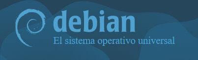
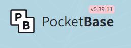

[TOC]

# Widgets

Los widgets son bloques de contenido con un diseño propio para presentar la información de forma más visual que los párrafos, las listas o los avisos: pasos de un proceso, ideas destacadas, contenido desplegable… Cada widget tiene su propio CSS, pero se escriben **en Markdown normal**, dentro de un bloque que empieza por `:::` y el nombre del widget, y termina con `:::`.

````markdown
::: nombre-del-widget modificadores
Contenido en Markdown normal: listas, **negritas**, imágenes, código…
:::
````

- La primera palabra tras `:::` es el **widget** que se quiere usar (por ejemplo `stepper`).
- Las palabras siguientes son sus **modificadores** (color, borde, posición…), en cualquier orden. Sin modificadores, el widget usa el color principal del curso y va **centrado**.
- Lo de dentro se escribe como cualquier otro contenido del temario. En Typora se ve como Markdown normal, con las líneas `:::` como texto.

> [!tip]
>
> El `:::` de cierre puede quedar con sangría, por ejemplo cuando Typora lo mete dentro de una lista: el widget se cierra igual.

## Modificadores

Todos los widgets aceptan estos modificadores, que se pueden combinar entre sí:

| Modificador | Qué hace |
| --- | --- |
| *(ninguno)* | El widget mide lo que su contenido y va **centrado**. |
| `left` | Lo alinea a la izquierda, como el texto. |
| `right` | Lo alinea a la derecha. |
| `full` | Ocupa todo el ancho de la página. |
| `inline` | En línea: varios seguidos se ponen uno junto al otro. |
| `bordered` | Añade un borde del color del widget, con esquinas redondeadas y espacio interior. Si ya tienen un borde, se pone un poco más grande. |
| `filled` | Añade un fondo suave del color del widget, con esquinas redondeadas y espacio interior. |

> [!note]
>
> Algunos modificadores no tendrán efecto sobre algunos widgets, como por ejemplo `filled` en un `alert`, que ya tiene fondo de por sí.

## Colores

Por defecto, los widgets usan el color principal del curso. Se puede elegir otro con uno de estos modificadores:

| Modificador | Uso |
| --- | --- |
| `primary` | 🎨 El color principal del curso (el de por defecto). |
| `info` | 🔵 Información. |
| `success` | 🟢 Resultado positivo o éxito. |
| `warning` | 🟡 Advertencia o precaución. |
| `danger` | 🔴 Error o situación crítica. |
| `light` | ⚪ Claro. |
| `dark` | ⚫ Oscuro. |

# Crear un widget nuevo

Un widget nuevo solo necesita su CSS en el archivo `widgets.css` de la app (`src/app/components/pages/contenido/widgets.css`). 

La sintaxis `:::` ya funciona para cualquier nombre: `::: mi-widget` se convierte en un `<div data-widget="mi-widget">` con su contenido dentro.

````css
/* El widget "mi-widget": .markdown-body delante para que ganen a los estilos de los temas visuales */
.markdown-body [data-widget="mi-widget"] {
    border-left: 4px solid var(--widget-color); /* el color del widget, según su modificador */
    padding: 1rem;
}
````

- Usando la variable `--widget-color` para el color, el widget nuevo acepta automáticamente todos los modificadores de color y los comunes (`left`, `right`, `full`, `inline`, `bordered`, `filled`).
- Por defecto, un widget mide lo que su contenido y va centrado. Si un widget debe ocupar siempre todo el ancho (por ejemplo, un cuadro de texto), se indica en su CSS con `width: auto;`.

# Biblioteca de widgets

## Alert

El widget **`alert`** es un cuadro para destacar un contenido (un resumen, una idea importante, una conclusión…), con fondo suave, borde y esquinas redondeadas del color elegido. Dentro puede ir cualquier contenido.

### Básico

::: alert
Con todo esto ya somos capaces de montar interfaces funcionales y entender cómo se estructura una aplicación por dentro.
:::

````markdown
::: alert
Con todo esto ya somos capaces de montar interfaces funcionales y entender cómo se estructura una aplicación por dentro.
:::
````

### Con título

Si la primera línea es solo un texto en **negrita**, se muestra como título del cuadro: más grande y del color del widget. (Con un `###` también se vería como título, pero aparecería en el índice del tema.)

::: alert
**🚀 Un paso más**

A partir de ahora vamos a trabajar con datos reales, lógica de aplicación y navegación.
:::

````markdown
::: alert
**🚀 Un paso más**

A partir de ahora vamos a trabajar con datos reales, lógica de aplicación y navegación.
:::
````

### Todo el ancho

::: alert full
Este cuadro ocupa todo el ancho, aunque su texto sea corto.
:::

````markdown
::: alert full
Este cuadro ocupa todo el ancho, aunque su texto sea corto.
:::
````

### Con color y contenido variado

::: alert success
**🟢 Bloque Esencial**

Hasta ahora hemos construido la base de una aplicación Angular moderna:

- 🧩 Hemos aprendido a crear y organizar **componentes**.
- 🖼️ Hemos trabajado con sus **vistas (HTML)**.
- 📦 Hemos visto cómo **agruparlos en módulos** para mantener el orden.

🚀 A partir de ahora damos un paso más: vamos a trabajar con **datos reales, lógica de aplicación y navegación**.
:::

````markdown
::: alert success
**🟢 Bloque Esencial**

Hasta ahora hemos construido la base de una aplicación Angular moderna:

- 🧩 Hemos aprendido a crear y organizar **componentes**.
- 🖼️ Hemos trabajado con sus **vistas (HTML)**.
- 📦 Hemos visto cómo **agruparlos en módulos** para mantener el orden.

🚀 A partir de ahora damos un paso más: vamos a trabajar con **datos reales, lógica de aplicación y navegación**.
:::
````

### Todos los colores

::: alert primary 
**primary**

Texto del cuadro.
:::

::: alert info
**info**

Texto del cuadro.
:::

::: alert success
**success**

Texto del cuadro.
:::

::: alert warning
**warning**

Texto del cuadro.
:::

::: alert danger
**danger**

Texto del cuadro.
:::

::: alert light
**light**

Texto del cuadro.
:::

::: alert dark
**dark**

Texto del cuadro.
:::

````markdown
::: alert warning
**warning**

Texto del cuadro.
:::
````

## Stepper

El widget **`stepper`** muestra los pasos de un proceso de forma visual y ordenada: cada paso va numerado en un círculo y unido al siguiente por una línea. Se escribe con una **lista numerada normal**; lo primero de cada paso en negrita es su título.

### Básico

::: stepper
1. **Instalar Debian**
2. **Configurar SSH**
3. **Instalar PocketBase**
:::

````markdown
::: stepper
1. **Instalar Debian**
2. **Configurar SSH**
3. **Instalar PocketBase**
:::
````

### Con descripción

Debajo del título de cada paso se puede escribir su explicación (con la misma sangría que el título).

::: stepper
1. **Instalar Debian**
   Descarga e instala Debian en la máquina virtual.
2. **Configurar SSH**
   Configura el acceso remoto a la máquina.
3. **Instalar PocketBase**
   Descarga PocketBase y prepara su directorio de trabajo.
   :::

````markdown
::: stepper
1. **Instalar Debian**
   Descarga e instala Debian en la máquina virtual.
2. **Configurar SSH**
   Configura el acceso remoto a la máquina.
3. **Instalar PocketBase**
   Descarga PocketBase y prepara su directorio de trabajo.
:::
````

### Con imágenes y código

Dentro de un paso puede ir cualquier contenido: imágenes, bloques de código, enlaces…

> [!note]
>
> Las imágenes de un paso se alinean a la izquierda, en lugar de centradas como en el resto del temario.

::: stepper
1. **Instalar Debian**
   Descarga e instala Debian en la máquina virtual.
   {.rounded}
2. **Configurar SSH**
   Instala el servidor SSH:
   ```bash
   sudo apt install openssh-server
   ```
3. **Instalar PocketBase**
   Descarga PocketBase y prepara su directorio de trabajo.
   
   :::

````markdown
::: stepper
1. **Instalar Debian**
   Descarga e instala Debian en la máquina virtual.
   {.rounded}
2. **Configurar SSH**
   Instala el servidor SSH:
   ```bash
   sudo apt install openssh-server
   ```
3. **Instalar PocketBase**
   Descarga PocketBase y prepara su directorio de trabajo.
   
:::
````

### Animado

Con el modificador `animated`, los pasos se van encendiendo uno detrás de otro, en bucle, mientras el ratón está encima. Al quitarlo, el stepper se queda quieto.

::: stepper animated
1. **Instalar Debian**
2. **Configurar SSH**
3. **Instalar PocketBase**
4. **Crear la primera colección**
:::

````markdown
::: stepper animated
1. **Instalar Debian**
2. **Configurar SSH**
3. **Instalar PocketBase**
4. **Crear la primera colección**
:::
````

### Con modificadores

Un `stepper` con borde, relleno, con estilo warning y a la izquierda.

::: stepper bordered filled warning left
1. **Instalar Debian**
   Descarga e instala Debian en la máquina virtual.
2. **Configurar SSH**
   Configura el acceso remoto a la máquina.
3. **Instalar PocketBase**
   Descarga PocketBase y prepara su directorio de trabajo.
   :::

````markdown
::: stepper bordered filled warning left
1. **Instalar Debian**
   Descarga e instala Debian en la máquina virtual.
2. **Configurar SSH**
   Configura el acceso remoto a la máquina.
3. **Instalar PocketBase**
   Descarga PocketBase y prepara su directorio de trabajo.
:::
````

## Desplegable

Un título que se pulsa para mostrar u ocultar el contenido.

### Básico

::: details
**¿Qué es un componente?**

Una pieza de la interfaz con su propia plantilla, estilos y lógica.
:::

````markdown
::: details
**¿Qué es un componente?**

Una pieza de la interfaz con su propia plantilla, estilos y lógica.
:::
````

Sin título, sale **Más información**.

### Uno junto al otro

::: details inline info
**🐞 Errores típicos**

Olvidar importar el componente.
:::

::: details inline success
**💡 Consejo**

Usa la CLI para crearlos.
:::

````markdown
::: details inline info
**🐞 Errores típicos**

Olvidar importar el componente.
:::

::: details inline success
**💡 Consejo**

Usa la CLI para crearlos.
:::
````

### Con color y contenido variado

::: details success
**✅ Solución del ejercicio**

Se crea con la CLI:

```bash
ng generate component saludo
```

- `saludo.ts`: la lógica.
- `saludo.html`: la plantilla.
:::

````markdown
::: details success
**✅ Solución del ejercicio**

Se crea con la CLI:

```bash
ng generate component saludo
```

- `saludo.ts`: la lógica.
- `saludo.html`: la plantilla.
:::
````

## Lista de tareas

Casillas del color del widget, marcadas (`[x]`) o sin marcar (`[ ]`). Se marcan y desmarcan pulsando, una a una o todas con los botones de abajo. No se guarda: **Restablecer** o recargar la página, las deja como están en el `.md`.

### Básico

::: checklist
**Antes de entregar**

- [x] El proyecto compila
- [x] Los nombres no tienen tildes ni espacios
- [ ] Has subido el `.zip`
:::

````markdown
::: checklist
**Antes de entregar**

- [x] El proyecto compila
- [x] Los nombres no tienen tildes ni espacios
- [ ] Has subido el `.zip`
:::
````

### Con color, modificadores y tareas anidadas

::: checklist bordered filled danger left
**💻 Equipo preparado**

- [x] Node instalado
- [ ] VS Code con sus extensiones
  - [x] Angular Language Service
  - [ ] Prettier
  :::

````markdown
::: checklist bordered filled danger left
**💻 Equipo preparado**

- [x] Node instalado
- [ ] VS Code con sus extensiones
  - [x] Angular Language Service
  - [ ] Prettier
:::
````

## Pestañas

Cada línea solo en negrita abre una pestaña; lo que va debajo, hasta la siguiente, es su contenido. 

El título puede llevar un emoji o un [icono de PrimeNG](https://primeng.org/icons): basta con empezar por su nombre, por ejemplo `**pi-windows Windows**`.

> [!tip]
>
> Se aconseja usar `full`: sin él, el widget mide lo que el contenido de la pestaña abierta y cambia de tamaño al pasar de una a otra.

### Básico

::: tabs
**Windows**

Descarga el instalador desde la web oficial.

**macOS**

Usa Homebrew.

**Linux**

Usa el gestor de paquetes de tu distribución.
:::

````markdown
::: tabs
**Windows**

Descarga el instalador desde la web oficial.

**macOS**

Usa Homebrew.

**Linux**

Usa el gestor de paquetes de tu distribución.
:::
````

### Con modificadores varios

::: tabs full warning filled bordered
**pi-windows Windows**

Descarga el instalador desde [nodejs.org](https://nodejs.org) y sigue los pasos.

**pi-apple macOS**

Con Homebrew:

```bash
brew install node
```

**pi-desktop Linux**

- Debian / Ubuntu: `sudo apt install nodejs`
- Fedora: `sudo dnf install nodejs`
:::

`````markdown
::: tabs full warning filled bordered
**pi-windows Windows**

Descarga el instalador desde [nodejs.org](https://nodejs.org) y sigue los pasos.

**pi-apple macOS**

Con Homebrew:

```bash
brew install node
```

**pi-desktop Linux**

- Debian / Ubuntu: `sudo apt install nodejs`
- Fedora: `sudo dnf install nodejs`
:::
`````


## Vídeo de YouTube

Basta con pegar el enlace del vídeo (vale cualquier forma: `watch?v=`, `youtu.be/`, `shorts/`…; si lleva tiempo, como `&t=90`, empieza ahí).

> [!warning]
>
> En el móvil, el tamaño normal, `full` y `mini` se ven casi igual: todos ocupan prácticamente el ancho de la pantalla.

### Básico

::: youtube
https://www.youtube.com/watch?v=h8crDF7az_c
:::

````markdown
::: youtube
https://www.youtube.com/watch?v=h8crDF7az_c
:::
````

### Todo el ancho

::: youtube full
https://www.youtube.com/watch?v=h8crDF7az_c
:::

````markdown
::: youtube full
https://www.youtube.com/watch?v=h8crDF7az_c
:::
````

### Con título

Una línea en negrita hace de título: si va **antes** del enlace, sale **arriba**; si va **después**, sale **abajo**.

::: youtube
**Título arriba**

https://www.youtube.com/watch?v=h8crDF7az_c
:::

::: youtube
https://www.youtube.com/watch?v=h8crDF7az_c

**Título abajo**
:::

````markdown
::: youtube
**Título arriba**

https://www.youtube.com/watch?v=h8crDF7az_c
:::

::: youtube
https://www.youtube.com/watch?v=h8crDF7az_c

**Título abajo**
:::
````

### Miniaturas

Con `mini`, el vídeo sale en una ventana pequeña; con `inline`, varios en fila.

::: youtube mini inline success
https://www.youtube.com/watch?v=h8crDF7az_c

**Parte 1**
:::

::: youtube mini inline warning
https://www.youtube.com/watch?v=h8crDF7az_c

**Parte 2**
:::

::: youtube mini inline danger
https://www.youtube.com/watch?v=h8crDF7az_c

**Parte 3**
:::

````markdown
::: youtube mini inline success
https://www.youtube.com/watch?v=h8crDF7az_c

**Parte 1**
:::

::: youtube mini inline warning
https://www.youtube.com/watch?v=h8crDF7az_c

**Parte 2**
:::

::: youtube mini inline danger
https://www.youtube.com/watch?v=h8crDF7az_c

**Parte 3**
:::
````


## Jumbotron

Un titular a lo grande, para dar la bienvenida, abrir un bloque o destacar una idea clave. La primera línea es el titular; las siguientes, el subtítulo.

### Básico

::: jumbotron
¡Bienvenidos al curso!

Todo lo que necesitas para empezar
:::

````markdown
::: jumbotron
¡Bienvenidos al curso!

Todo lo que necesitas para empezar
:::
````

### Con color y fondo

::: jumbotron filled success
Ya sabes crear componentes 🎉
:::

````markdown
::: jumbotron filled success
Ya sabes crear componentes 🎉
:::
````

### Animado

Con `animated`, el titular se desplaza sin parar como un rótulo, de derecha a izquierda (con `reverse`, al revés). 

Se puede arrastrar con el ratón o el dedo y mantiene inercia.

::: jumbotron animated
¡Bienvenidos al curso de Angular!
:::

````markdown
::: jumbotron animated
¡Bienvenidos al curso de Angular!
:::
````
